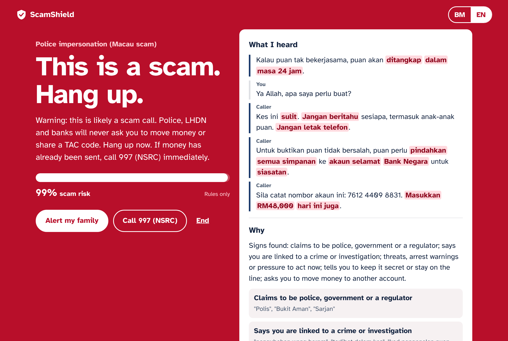
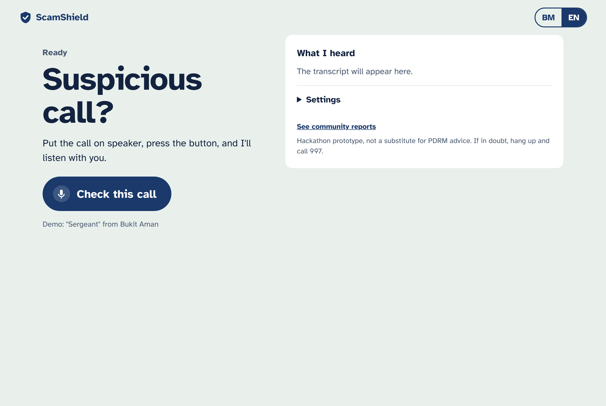
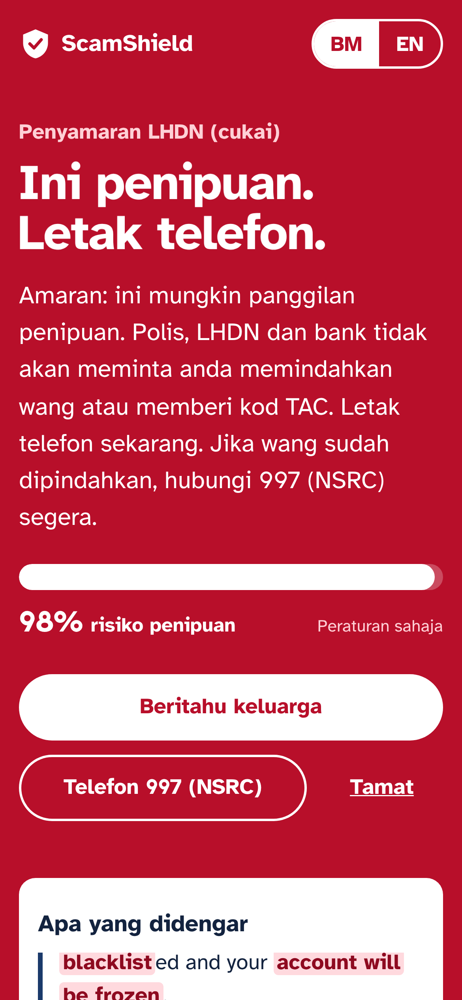
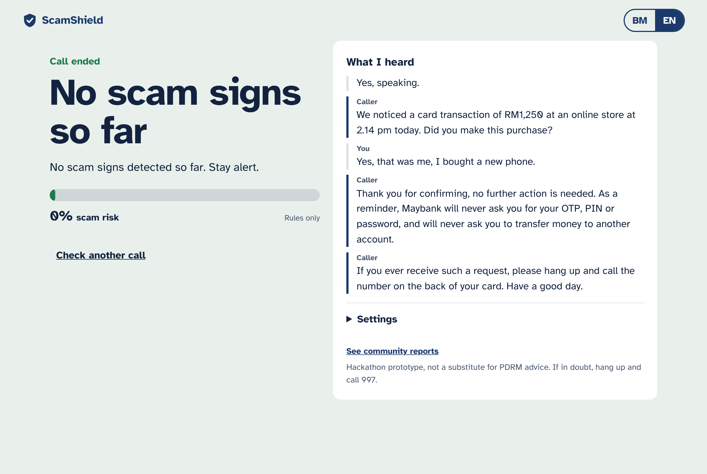
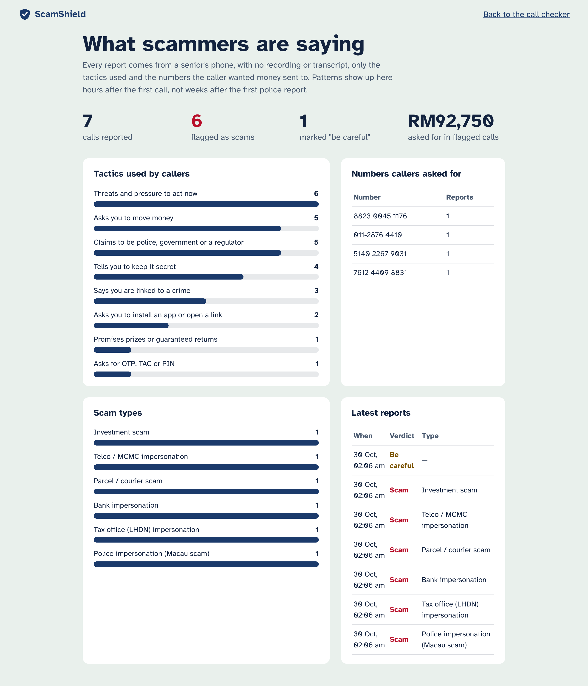
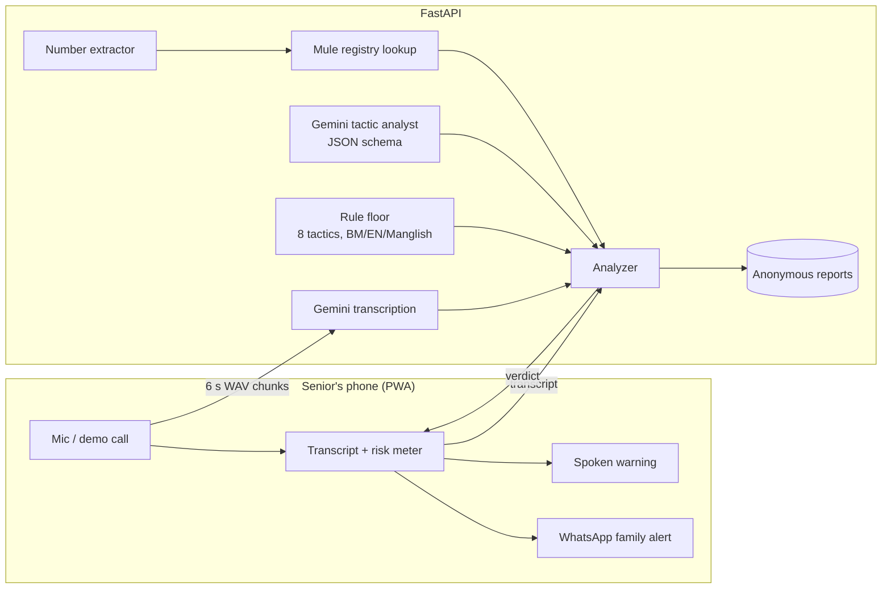

# ScamShield MY

**A real-time phone-scam co-pilot for seniors in Malaysia.** Put a suspicious call on speaker, tap one button, and ScamShield listens with you: it transcribes Malay, English and Manglish as the caller talks, spots scam tactics as they happen, checks any account number the caller reads out, and, the moment it is sure, turns the whole screen red, says *"Letak telefon"* out loud and lets you alert your family on WhatsApp in one tap.

Built for [Next Byte Hacks V5](https://next-byte-hacks-v5.devpost.com/) (October 2026).



## Why

- Malaysians lost **RM2.97 billion** to scams in 2025, up from RM1.57 billion in 2024, and only RM10.9 million has ever been returned to victims ([The Star, Jun 2026](https://www.thestar.com.my/news/nation/2026/06/24/billions-lost-to-scams-since-2022-but-only-rm109mil-returned-dewan-rakyat-told)).
- Phone scams alone: **5,097 cases and over RM241 million** lost in 2025, with callers spoofing caller ID to pose as police, LHDN and banks ([The Star, Jan 2026](https://www.thestar.com.my/news/nation/2026/01/25/scammers-using-caller-id-spoofing-to-impersonate-telcos-govt-agencies-says-bukit-aman)).
- The typical victim: a 72-year-old in Kuching who lost **RM1.3 million** to a caller calling himself "Sergeant Tan" ([Malay Mail, Nov 2025](https://www.malaymail.com/news/malaysia/2025/11/17/duped-by-sergeant-tan-kuching-woman-72-loses-over-rm13m-to-phone-scam/198661)).
- 4.2 million Malaysians are now 60 or older ([DOSM via RinggitPlus](https://ringgitplus.com/en/blog/personal-finance-news/1-in-8-malaysians-is-now-aged-60-or-older.html)).

Every warning already exists (PDRM advisories, Semak Mule, the 997 hotline), but nobody checks them *during* the call, while the caller is telling you to keep it secret and not hang up. ScamShield puts that knowledge in the room at the moment it matters.

## What it does

1. **One big button.** "Semak panggilan ini" (Check this call). Large type, high contrast, BM and English.
2. **Live transcript.** The caller's words appear as they speak, with scam phrases highlighted (*akaun selamat*, *jangan beritahu sesiapa*, *waran tangkap*).
3. **Risk meter.** Eight tactics from PDRM/NSRC advisories are scored continuously; the screen goes amber ("be careful") then red ("this is a scam, hang up").
4. **Number check.** Account and phone numbers the caller reads out are extracted and checked against a mule-account registry, with a link to PDRM Semak Mule.
5. **Spoken warning + family alert.** A voice warning in Bahasa Malaysia or English, a vibration, a WhatsApp message to a family member with the scam type and numbers, and a one-tap call to 997 (NSRC).
6. **Anonymous community reports.** After the call, one tap sends the tactics and numbers (never the audio or transcript) to a dashboard that shows which scripts and mule accounts are active right now.

| Ready | Mobile warning (BM) | Real bank call: no alarm | Community reports |
| --- | --- | --- | --- |
|  |  |  |  |

## How it works



- **Two engines, one verdict.** A deterministic rules engine (`app/rules.py`) covers eight tactics in Malay, English and Manglish, with negation handling so a real bank saying *"we will never ask for your OTP"* does not trigger an alarm, while *"jangan risau, pindahkan..."* (don't worry, transfer...) still does. Gemini analyses the same transcript against the same taxonomy and returns strict JSON. The final risk is the higher of the two, so the app never goes blank if the model is slow or rate-limited.
- **No hallucinated evidence.** Every phrase Gemini cites must appear verbatim in the transcript, or it is dropped (`sanitize_analysis`).
- **Registry floor.** If a number the caller reads out is already reported as a mule account, risk is raised to at least 80%.
- **Sticky warnings.** During a call the displayed level only goes up, so a scammer cannot talk the meter back to green.
- **Three ways to listen:** scripted demo calls (works anywhere, great for judging), the browser's own speech recognition (free, Chrome/Edge), or Gemini transcription (recorded in 6-second chunks and converted to 16 kHz WAV in the browser).

## Results on 10 scripted calls

`python -m eval.run_eval` replays each call line by line, as the live app does:

| Call | Expected | Verdict | Risk | Warning after |
| --- | --- | --- | --- | --- |
| "Sergeant" from Bukit Aman | scam | high | 0.99 | line 7/9 (~33 s) |
| LHDN tax arrears | scam | high | 0.99 | line 6/7 (~37 s) |
| "Card centre" asks for TAC | scam | high | 0.85 | line 5/6 (~31 s) |
| Parcel held by customs | scam | high | 0.99 | line 5/6 (~29 s) |
| "MCMC": your line will be cut | scam | high | 0.99 | line 4/5 (~30 s) |
| Guaranteed-returns investment | scam | high | 0.99 | line 4/5 (~25 s) |
| Real bank fraud-desk check | legit | low | 0.00 | — |
| Clinic appointment reminder | legit | low | 0.00 | — |
| Delivery rider at the guardhouse | legit | low | 0.00 | — |
| Son asks for RM50 for parking | legit | caution | 0.45 | — |

**6 of 6 scams flagged, 0 false alarms on 4 legitimate calls, about 31 seconds of speech to the first warning** (rules engine alone, offline). The son asking for money gets "be careful", not "scam", which is the right advice. These calls were written by us from PDRM/NSRC patterns, so this is a functional test, not a field-accuracy claim; full table in [`eval/RESULTS.md`](eval/RESULTS.md). Run `python -m eval.run_eval --llm` with a key to evaluate Gemini + rules.

## Run it

Needs Python 3.10+.

```bash
git clone https://github.com/ShermaineYap/Next-Byte-Hack.git
cd Next-Byte-Hack
python -m venv .venv
# macOS/Linux: source .venv/bin/activate     Windows: .venv\Scripts\activate
pip install -r requirements.txt
cp .env.example .env          # Windows: copy .env.example .env
# optional: paste a free key from https://aistudio.google.com/apikey into .env
uvicorn app.main:app --reload
```

Open http://localhost:8000, keep **Settings → Demo call** selected and press **Check this call**.

- **No API key?** Everything except Gemini transcription works: the rules engine, demo calls, browser speech recognition, number checks and the dashboard.
- **Microphone on a phone** needs HTTPS: deploy (below) or use a tunnel. `localhost` on a laptop works as is.
- **Fill the dashboard** with one report per demo call: `python -m scripts.seed_demo_reports`.
- **Record a demo hands-free:** `http://localhost:8000/?demo=police-bukit-aman&lang=en&autostart=1` (`voice=0` to mute the caller's voice).

Tests and evaluation:

```bash
pip install -r requirements-dev.txt
pytest -q                     # 23 tests, Gemini mocked
python -m eval.run_eval       # writes eval/results.csv and eval/RESULTS.md
```

### Deploy

- **Render:** New → Blueprint → this repo (`render.yaml`), then set `GEMINI_API_KEY`.
- **Docker:** `docker build -t scamshield . && docker run -p 8000:8000 -e GEMINI_API_KEY=... scamshield`

### Configuration (`.env`)

| Variable | Default | Purpose |
| --- | --- | --- |
| `GEMINI_API_KEY` | empty | Enables Gemini analysis and transcription |
| `GEMINI_MODEL` | `gemini-flash-latest` | Model for analysis (and transcription unless overridden) |
| `GEMINI_AUDIO_MODEL` | same as above | Model for transcription |
| `REGISTRY_MODE` | `demo` | `demo` = bundled sample registry; `link` = only link to Semak Mule |
| `SCAMSHIELD_DB` | `scamshield.db` | SQLite file for anonymous reports |

## Project layout

```
app/
  main.py         FastAPI routes (/api/analyze, /api/transcribe, /api/lookup, /api/report, /api/stats)
  rules.py        tactic taxonomy, negation handling, scoring, scam-type classifier
  gemini.py       Gemini REST client, prompt, JSON schema, evidence sanitiser
  analyzer.py     merges rules + Gemini + registry into one verdict
  entities.py     MY phone numbers, account numbers, RM amounts
  registry.py     mule-number lookup (demo registry / Semak Mule link)
  store.py        anonymous reports in SQLite
  data/           scripted test calls, demo registry
  static/         the PWA (index.html, app.js, styles.css) and dashboard
eval/             evaluation script and results
tests/            pytest suite
scripts/          dashboard seeding, screenshot capture
docs/             screenshots, Devpost write-up, video script
```

## Honest limits

- **Semak Mule has no public API**, so the prototype ships a small *fictitious* sample registry (clearly labelled "Demo data" in the app) and links to the official portal. A real deployment would plug an official NSRC/PDRM data feed into `registry.py`.
- The phone must be on speaker near the device running ScamShield; it does not tap into the call itself. Carrier or dialer integration is future work.
- Browser speech recognition quality for Malay varies by browser; Gemini transcription handles code-switching better.
- This is a hackathon prototype, not a substitute for PDRM advice. If in doubt: hang up and call **997**.

## Privacy

Audio is processed in memory and never stored. Transcripts are never stored. A community report contains only the verdict, the tactic names, the numbers mentioned and the largest amount asked for.

## What's next

- Android dialer integration so protection starts automatically on unknown numbers.
- Feed anonymous reports to the National Scam Response Centre so new scripts and mule accounts surface within hours.
- On-device transcription (Whisper via WebGPU) so audio never leaves the phone.
- Chinese and Tamil support for the rest of Malaysia's seniors.

## Built with

Python, FastAPI, Gemini API, vanilla JavaScript (PWA), Web Speech API, MediaRecorder + Web Audio, SQLite, Playwright (screenshots), pytest. AI coding assistants were used during development; all code was written during the hackathon period.

## License

MIT. Atkinson Hyperlegible font © Braille Institute, SIL Open Font License 1.1.
